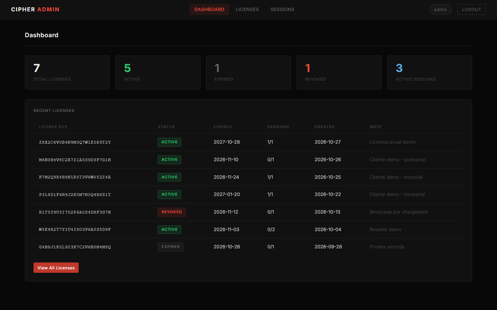
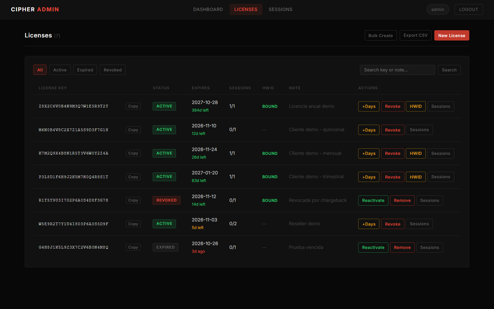
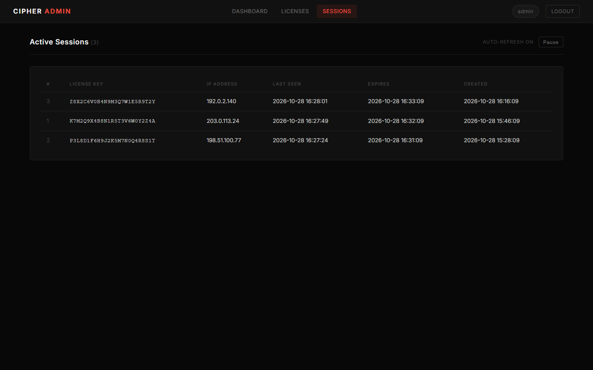
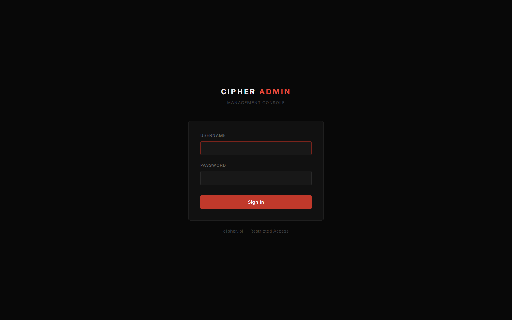
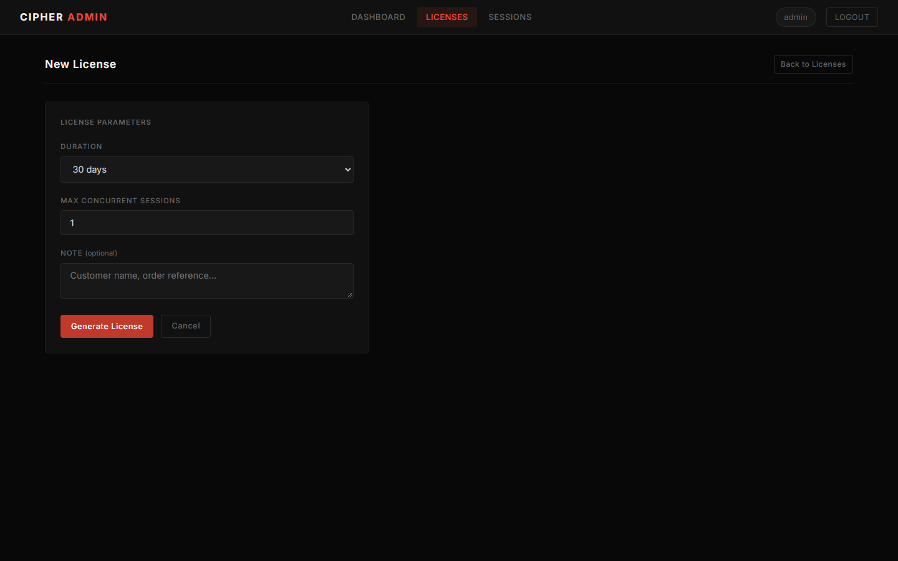

# Cipher License API

Backend de **licencias, sesiones y distribución segura de binarios** para el cliente de escritorio de Cipher. El cliente se autentica con una clave de licencia y el identificador de su máquina (HWID), recibe un JWT de vida corta atado a su IP, mantiene la sesión con heartbeats y descarga los binarios cifrados con AES-256 directamente desde el servidor. Así los binarios nunca se distribuyen en texto plano.

Incluye un **panel web de administración** y una **CLI** para gestionar licencias y ver sesiones activas.



## Stack

| Capa | Tecnología |
| --- | --- |
| API | Python 3.12, Flask 3 (application factory + blueprints) |
| Base de datos | PostgreSQL (Supabase en producción), `psycopg2` con pool de conexiones |
| Autenticación | JWT HS256 (PyJWT), token admin Bearer |
| Criptografía | AES-256-CBC + PKCS7 (`cryptography`), SHA-256 para hashes de token |
| Protección | Flask-Limiter (por IP) + `limit_req` de Nginx |
| Despliegue | Gunicorn + systemd + Nginx con TLS (Let's Encrypt) en un VPS Ubuntu |
| Tests | pytest: 105 tests |

## Flujo del cliente

```
Cliente                                      API                                   PostgreSQL
  │ POST /api/auth {license_key, hwid}        │                                        │
  │──────────────────────────────────────────>│ valida formato, estado y vencimiento   │
  │                                           │ vincula HWID en el primer uso ────────>│ licenses.hwid
  │                                           │ reemplaza la sesión anterior ─────────>│ sessions
  │<─────────── 200 {jwt_token, expires_at} ──│ JWT {license_key, ip, iat, exp=5 min}  │
  │                                           │                                        │
  │ GET /api/download/{loader|driver|cheat}   │                                        │
  │   Authorization: Bearer <jwt>             │ verifica firma, vencimiento e IP       │
  │<──────────────── binario cifrado (AES) ───│                                        │
  │                                           │                                        │
  │ POST /api/heartbeat  (cada 30 s)          │ sha256(jwt) → actualiza last_seen ────>│
  │<──────────── {status: alive, next: 30} ───│                                        │
```

Un hilo de fondo limpia cada 5 minutos las sesiones vencidas o sin heartbeat.

## Funcionalidades

- **Licencias:** claves de 25 caracteres generadas con `secrets`. Tienen estado (`active`, `expired` o `revoked`), vencimiento, cantidad máxima de sesiones y una nota libre.
- **Vínculo con la máquina (HWID):** la licencia queda atada al equipo en el primer login. Si se intenta usar desde otra máquina se responde `403`, y el administrador puede liberar el vínculo.
- **Sesiones:** una sesión activa por licencia. Un nuevo login reemplaza a la anterior, así el usuario puede volver a entrar si su cliente se cerró mal. En la base se guarda solo el hash SHA-256 del JWT, nunca el token.
- **JWT atado a la IP:** si un token se usa desde otra IP, se rechaza con `403`.
- **Distribución cifrada:** los binarios se cifran fuera de línea con `scripts/encrypt_binaries.py` y la API los entrega solo a sesiones válidas.
- **Administración:** API REST protegida por token, panel web y CLI (`tools/admin.py`).
- **Auditoría:** cada intento de autenticación queda registrado en `auth_logs` con su motivo de rechazo.

## Capturas

| Licencias | Sesiones activas (auto-refresh) |
| --- | --- |
|  |  |

| Login (solo localhost, con bloqueo por fuerza bruta) | Alta de licencia |
| --- | --- |
|  |  |

Todos los datos de las capturas son ficticios: las claves son inventadas y las IPs pertenecen a los rangos de documentación (RFC 5737).

## Arquitectura

```
api_server/
├── app.py              # Application factory: config, pool, limiter, blueprints, cleanup
├── config.py           # Configuración por variables de entorno
├── database.py         # Pool de conexiones y context manager de cursores
├── models.py           # License, Session (SQL parametrizado)
├── routes/             # auth, heartbeat, download, admin (+ tests)
├── middleware/         # require_jwt_auth, rate limiter, auth admin (+ tests)
└── utils/              # jwt_utils, encryption, key_generator, license_service,
                        # session_cleanup, auth_logger (+ tests)
scripts/                # Esquema SQL, init/migraciones, cifrado de binarios
tools/                  # Panel web (Flask + Jinja) y CLI de administración
templates/              # Vistas del panel
deployment/             # systemd, Nginx, scripts de setup y despliegue al VPS
```

### Modelo de datos

```
licenses (key PK lógica, status, expires_at, max_sessions, hwid, note, created_at)
   │ 1
   │
   └──< sessions (license_key FK ON DELETE CASCADE, jwt_token_hash, ip_address,
   │              last_seen, expires_at, created_at)
   │
auth_logs (license_key, ip_address, success, reason, timestamp)
```

Hay `CHECK` sobre `status` y `max_sessions`, e índices sobre `licenses(key, status, expires_at)`, sobre `sessions(license_key, expires_at)` (compuesto) y sobre `sessions(last_seen)` y `auth_logs(timestamp)`.

### Decisiones relevantes

- **JWT corto + heartbeat** en lugar de sesiones largas: un token robado deja de servir en 5 minutos y además está atado a la IP de origen. El heartbeat permite saber en tiempo real quién está conectado.
- **Hash del token en la base:** aunque se filtre la tabla `sessions`, no hay tokens utilizables.
- **Cifrado fuera de línea:** el servidor solo guarda y entrega binarios ya cifrados; la clave AES se configura por variable de entorno y nunca se versiona.
- **Doble capa de rate limiting:** Nginx corta el abuso antes de llegar a Python y Flask-Limiter aplica límites por endpoint (10/min en auth, 60/min en el resto).

## API

| Método | Ruta | Autenticación | Descripción |
| --- | --- | --- | --- |
| GET | `/health` | — | Estado del servicio |
| POST | `/api/auth` | — (10/min por IP) | Login con `license_key` + `hwid` → JWT |
| POST | `/api/heartbeat` | JWT | Mantiene viva la sesión |
| GET | `/api/download/loader` · `/driver` · `/cheat` | JWT (60/min) | Descarga del binario cifrado |
| POST | `/admin/license/create` | Token admin | Alta de licencia |
| POST | `/admin/license/revoke` | Token admin | Revocación (cierra sus sesiones) |
| POST | `/admin/license/extend` | Token admin | Extiende el vencimiento |
| GET | `/admin/licenses` | Token admin | Listado con filtros y paginación |
| GET | `/admin/sessions` | Token admin | Sesiones activas |

Ejemplo real contra la base de demostración:

```bash
$ curl -s -X POST localhost:5005/api/auth -H 'Content-Type: application/json' \
    -d '{"license_key":"M6N0B4V8C2X7Z1A5S9D3F7G1H","hwid":"A1B2C3D4E5F6A7B8C9D0E1F2"}'
{"expires_at":"2026-10-28T16:34:09.384936Z","jwt_token":"eyJhbGciOi...","message":"Authentication successful"}

$ curl -s -X POST localhost:5005/api/heartbeat -H "Authorization: Bearer $JWT"
{"next_heartbeat":30,"status":"alive"}

# La misma licencia desde otra máquina
{"error":"License bound to another machine"}          # 403

# Licencia revocada
{"error":"License revoked"}                           # 403

# 11 intentos seguidos desde la misma IP
401 401 401 401 401 401 401 429 429 429 429
```

| Código | Significado |
| --- | --- |
| 400 | Cuerpo inválido o clave con formato incorrecto |
| 401 | Clave inexistente, JWT ausente, inválido o vencido |
| 403 | Licencia vencida o revocada, HWID distinto o IP distinta a la del token |
| 429 | Rate limit superado |

## Ejecutar localmente

Requisitos: Python 3.12 y PostgreSQL 14+.

```bash
python -m venv .venv && source .venv/bin/activate     # Windows: .venv\Scripts\activate
pip install -r api_server/requirements.txt

createdb cipher_license
psql -d cipher_license -f scripts/schema.sql

cp api_server/.env.example api_server/.env.local      # completar valores
python -c "from api_server.app import app; app.run(port=5000)"
```

Panel de administración (escucha solo en `127.0.0.1`):

```bash
ADMIN_USERNAME=admin ADMIN_PASSWORD=<elegí-una> python tools/web_admin.py   # http://127.0.0.1:5001
```

CLI:

```bash
python tools/admin.py create --expires 2026-12-31 --sessions 1 --note "Cliente X"
python tools/admin.py list --status active
python tools/admin.py sessions
```

### Variables de entorno principales

| Variable | Uso |
| --- | --- |
| `DATABASE_URL` | Cadena de conexión a PostgreSQL |
| `JWT_SECRET_KEY` / `JWT_EXPIRATION_MINUTES` | Firma y duración del JWT (5 min por defecto) |
| `AES_ENCRYPTION_KEY` | Clave AES-256 en hex (64 caracteres) |
| `ADMIN_TOKEN` | Token Bearer de la API admin |
| `RATE_LIMIT_AUTH` / `RATE_LIMIT_API` | Límites por IP |
| `SESSION_HEARTBEAT_TIMEOUT_SECONDS` | Inactividad antes de dar la sesión por muerta |

La lista completa está en [`api_server/.env.example`](api_server/.env.example).

## Pruebas

```bash
createdb cipher_license_test && psql -d cipher_license_test -f scripts/schema.sql
TZ=UTC pytest
```

Resultado verificado el 28/10/2026: **105 passed**. Hay tests unitarios (JWT, cifrado, generación de claves y servicio de licencias, con mocks) y tests de integración contra PostgreSQL (auth, heartbeat, rate limiting y endpoints admin). Se ejecutan en UTC porque la API y la base trabajan con timestamps UTC sin zona horaria, igual que en el servidor de producción.

### Correcciones aplicadas al preparar esta versión

Al volver a correr la suite completa contra una base limpia aparecieron problemas reales, que quedaron corregidos:

- **Los rate limits de Flask no se aplicaban.** `limiter.limit(...)` envolvía la vista, pero el resultado no se volvía a registrar en `app.view_functions`, así que Flask seguía usando la vista sin límite. Ahora se reasigna la vista envuelta, y los tests de rate limiting lo verifican.
- **El `iat` del JWT salía mal en hosts que no están en UTC.** `datetime.utcnow().timestamp()` interpreta la hora UTC como si fuera local. Se reemplazó por `datetime.now(timezone.utc)`.
- **El esquema SQL no tenía la columna `hwid`**, aunque el código la usa.
- **El panel admin tenía una contraseña por defecto en el código.** Ahora se exige `ADMIN_PASSWORD` y el panel no arranca sin ella.
- Tests que habían quedado desactualizados respecto de la política de sesiones (un login nuevo reemplaza al anterior) y del formato de respuesta del middleware.

## Despliegue

`deployment/` contiene la unidad de systemd (Gunicorn como `www-data`), la configuración de Nginx (TLS, `limit_req_zone` y proxy reverso) y los scripts de aprovisionamiento y despliegue al VPS. Las IPs, rutas y claves reales se reemplazaron por marcadores.

## Licencia

Código propietario. Todos los derechos reservados.
